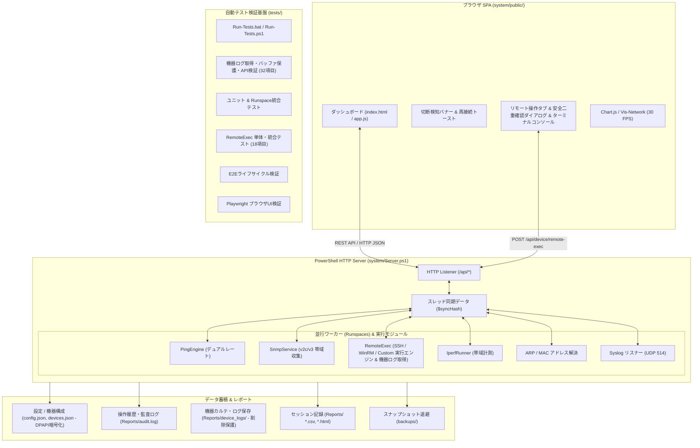

# 🌐 Network Device Monitor & Diagnostic Tool

[](https://microsoft.com/powershell)
[](https://developer.mozilla.org/en-US/docs/Web/JavaScript)
[](LICENSE)
[](https://www.microsoft.com/windows)

**Windows PowerShell 製バックエンドHTTPサーバーとモダンSPAフロントエンド（Vis-Network / Chart.js / Web Audio）で構成された、エージェントレス型のオールインワン・ネットワーク機器監視＆診断ツールです。**

---

## 🌟 主な機能 (Key Features)

| カテゴリ | 機能 | 説明 |
| :--- | :--- | :--- |
| **⚡ 死活監視 (Ping)** | **デュアルレート高精度Ping** | 通常監視（1.0s等）に加え、最重要機器2台を0.1秒、他機器を5.0秒で並行監視するデュアルレート監視をサポート。 |
| **📡 Syslog / SNMP Trap 受信** | **機器からの通知を一覧表示** | 機器から届く Syslog と SNMP Trap（v1 / v2c）を受信し、重要度付きで表示。実際の受信ポートも画面で確認可能。 |
| **🧭 経路トレース** | **構成図から右クリックで実行** | このPCから機器までに通る機器を一覧表示し、構成図上でも強調表示。 |
| **📑 CSV 入出力** | **Excel で一括編集** | 機器一覧を CSV で書き出し・取り込み（同じIPは更新、新しいIPは追加）。 |
| **📊 通信品質解析** | **パケットロス率 & ジッター算出** | 直近サンプリングからのリアルタイムパケット損失率 (%) および RFC 3550 準拠ジッター (ms) を自動計算。 |
| **⏱ 稼働タイムライン** | **到達性ヒートマップ** | 画面上部に直近の稼働品質（緑: 正常 / 黄: 高遅延 / 赤: 障害 / 灰: 停止）をカラーバーで時系列表示。 |
| **🔔 外部・音声アラート** | **Webhook & Web Audio 音声通知** | Slack/Teams/Discord への自動 Webhook POST、およびブラウザ側でのビープ/チャイム音波合成アラート。 |
| **🌐 トポロジー可視化** | **動的リンクアラートマップ** | `Vis-Network` による機器配置・接続線描画。障害・高遅延時に接続線が赤・黄へと動的カラーチェンジ。 |
| **🔍 SNMP 診断** | **SNMP v2c / v3 詳細情報取得** | インターフェース使用量、Tx/Rx帯域、エラーパケット、システム情報をエージェントレスで収集。 |
| **🔧 リモート機器制御** | **SSH / WinRM / カスタム遠隔制御** | 登録機器に対するワンクリック遠隔再起動および任意コマンド実行。Windows DPAPI によるパスワード暗号化保管、プリセットコマンド管理を完備。 |
| **🔒 外部サイト遮断 & コマンド注入防止** | **CSRF 対策 & 安全な引数受け渡し** | 監視画面以外のWebサイトからの API 呼び出しを `Origin` / `Sec-Fetch-Site` ヘッダーで判定して `403` で遮断。SSH/WinRM のコマンドは正しくエスケープ・環境変数経由で渡し、監視PC上で意図しない命令が動くことを防止。 |
| **🛡️ 安全二重確認 & ログ出力** | **誤操作防止ダイアログ & ターミナル** | 対象機器名・IPを明示する二重確認モーダルによる安全防護。実行結果・終了コード・stdout/stderrをリアルタイムターミナル出力。 |
| **📋 機器ログ遠隔取得** | **カルテ閲覧・プリセット & 安全保護** | Cisco/Yamaha/Linux/Windowsのシステムログ（syslog/journalctl/イベントログ）をワンクリック遠隔取得。等幅ダークビューアー、リアルタイム検索ハイライト・絞り込み、1MB/5MB二重保護、ローカル保存・再ダウンロード完備。 |
| **📋 操作履歴 & 監査ログ** | **改ざん防止 Audit Log & UI Viewer** | 全ての変更操作およびリモート制御履歴を `Reports/audit.log` へ永続記録。画面ヘッダーの操作履歴モーダルから即座に確認可能。 |
| **🚀 帯域計測** | **Iperf3 統合スループット診断** | 同梱の `iperf3` をバックグラウンドで自動制御し、実効スループットをライブ計測・ログ保存。 |
| **📡 UI切断耐性 & 自動復旧** | **切断検知バナー & 自動トースト** | 3回連続ステータス取得失敗で切断警告バナー表示、通信復旧時に自動復旧トースト表示。30 FPS間引きで低CPU負荷。 |
| **⏱ 24/7 常時稼働 & 耐障害性** | **無人連続運用 & 例外自己防護** | ブラウザ切断時の自動終了を解除する無人モード（`autoShutdownOnDisconnect: false`）、ソケット切断例外自己吸収、動的瞬断・復旧追跡を完備。 |
| **💾 バックアップ & 復元** | **1クリック設定エクスポート/インポート** | 登録機器リスト・トポロジー座標・監視パラメータを1つの JSON として即座にバックアップ・復元。 |
| **📑 レポート & 保守** | **日本語CSVサマリー & 自動パージ** | セッション終了時に詳細な日本語サマリーブロックを出力。指定日数を超えた古いログの自動クリーンアップ。 |
| **🧪 総合自動テスト** | **6大テストスイート統合検証 (全113テスト)** | 機器ログ取得、ユニット、リモート制御、Runspace統合、E2Eライフサイクル、ブラウザUI自動検証をワンクリック（`Run-Tests.bat`）で一括実行（全113テスト100%合格保証）。 |
| **🛠️ 簡単セットアップ** | **ワンクリック起動** | 外部Webサーバー不要。`Start-Monitor.bat` をダブルクリックするだけで即座にローカルサーバーが起動。 |

---

## 🏗️ システム構成 (Architecture)



---

## 📁 ディレクトリ構成 (Directory Structure)

本リポジトリは、運用担当者が日常的に使用する **「ユーザー操作部」**、監視処理やAPIを担う **「システム内部実装部」**、そしてシステムの品質を保証する **「自動テスト検証部」** の3層に明確に分離されています。

```
NetworkDeviceMonitor/
│
├── 📂 【ユーザー操作部】（プロジェクトルート）
│   ├── Start-Monitor.bat              # 🚀 起動用バッチファイル（Windows監視サーバー一発起動）
│   ├── 利用手順書.md                  # 📘 エンドユーザー・運用担当者向け利用マニュアル（平易な用語解説付き）
│   ├── README.md                      # 📖 プロジェクト概要・仕様書（本ドキュメント）
│   └── LICENSE                        # 📄 MIT License
│
├── 📂 【システム内部実装部】（system/ フォルダ）
│   ├── Server.ps1                     # メインバックエンドHTTPサーバー＆監視コーディネーター
│   ├── Watchdog.ps1                   # 監視サーバー外形死活監視＆自己治癒（自動再起動）
│   ├── Check-Prerequisites.ps1        # 前提モジュール自動検査・インストール
│   ├── Ensure-Utf8Bom.ps1             # PowerShell 5.1 文字化け防止（UTF-8 BOM）検証ツール
│   ├── config.json                    # システム全体設定ファイル
│   ├── devices.json                   # 監視対象デバイス設定ファイル
│   ├── README.md                      # 管理者・開発者向け詳細設計書
│   ├── SPECIFICATION.md               # システム機能仕様書
│   ├── modules/                       # バックエンド機能モジュール群
│   │   ├── Common.psm1                # 共通処理・Runspace生成・設定JSON暗号化保存（DPAPI）
│   │   ├── RemoteExec.psm1            # 🔧 リモート制御実行エンジン（SSH / WinRM / カスタム・安全タイムアウト管理）
│   │   ├── PingEngine.psm1            # 高精度Ping死活監視・パケットロス・ジッター計算
│   │   ├── SnmpService.psm1           # SNMP v2c/v3 トラフィック・インターフェース情報取得
│   │   ├── ReportGenerator.psm1       # CSVセッション記録・点検報告書（HTML）生成
│   │   ├── AlertManager.psm1          # Webhook通知・音声アラート・消音タイマー管理
│   │   └── IperfRunner.psm1           # 帯域計測（iperf3）実行管理
│   ├── backups/                       # 機器構成・設定の自動スナップショット退避先（最新20世代）
│   ├── iperf3.18_64/                  # iperf3 実行バイナリ & NOTICE.md
│   └── public/                        # フロントエンド静的アセット (SPA)
│       ├── index.html                 # メインSPA画面（リモート操作・二重確認モーダル搭載）
│       ├── style.css                  # カスタムスタイルシート（レスポンシブ・警告スタイル・ターミナルコンソール）
│       ├── app.js                     # UI制御・Chart.jsグラフ描画・リモート操作制御・切断復旧ハンドラー
│       ├── chart.js                   # チャート描画ライブラリ
│       └── vis-network.min.js         # トポロジー図描画エンジン
│
├── 📂 【自動テスト検証部】（tests/ フォルダ）
│   ├── Run-Tests.bat                  # 🧪 自動テスト一括実行ランチャー（ワンクリック実行）
│   ├── Run-Tests.ps1                  # ⚙️ 自動テスト総合管理スクリプト（PowerShell実行用）
│   ├── DeviceLog.Tests.ps1            # 📋 機器ログ取得テスト（プリセット・安全性・バッファ保護・API検証）
│   ├── Monitor.Tests.ps1              # 🔬 ユニットテスト（個別モジュール機能検証）
│   ├── RemoteExec.Tests.ps1           # 🔧 リモート制御テスト（SSH/WinRM/カスタム実行・タイムアウト・DPAPI暗号化・監査ログ）
│   ├── Runspace.Tests.ps1             # 🔄 Runspace統合テスト（並行スレッド動作・API契約検証）
│   ├── E2E-Lifecycle.Tests.ps1        # 🚀 E2Eライフサイクル検証（起動→監視→終了→CSV生成の通し確認）
│   └── ui_verification.py             # 🌐 ブラウザUI自動テスト（Playwright画面検証・切断バナー動作）
│
└── 📂 【レポート出力先】（Reports/ フォルダ）
    ├── audit.log                      # 🛡️ 操作履歴・監査ログ（設定変更・リモート再起動・コマンド実行記録）
    ├── device_logs/                   # 📋 取得済み機器ログ保管先（{IP}_{日時}.log - パージ保護）
    └── sessions/ (起動日時)/          # 実行時ログ・CSVサマリーレポート・点検報告書HTML（自動生成）
```

---

## 🚀 起動方法 (Quick Start)

### 前提要件
* **OS**: Windows 10 / 11 / Windows Server 2016 以降
* **PowerShell**: Windows PowerShell 5.1 または PowerShell 7+
* **ブラウザ**: Google Chrome / Microsoft Edge / Firefox

### 監視の開始手順
1. 本リポジトリをクローンまたはダウンロードします。
   ```bash
   git clone https://github.com/Shuntaro1996/network-device-monitor.git
   ```
2. フォルダ内の **`Start-Monitor.bat`** をダブルクリックします。
3. 自動的にブラウザが起動し、監視ダッシュボード（`http://localhost:8081`）が表示されます。

> **💡 選択プロンプトの自動進行について**:
> システム起動時やセットアップ確認時の選択肢プロンプトは、運用ルールに基づき原則として「4」を選択したものとしてスムーズに自動進行します。

---

## 🧪 自動テスト実行手順 (Automated Testing)

本システムには、システムの健全性をワンクリックで総合検査できる自動テストスイートが備わっています。

### 実行手順
- **ワンクリック実行（推奨）**:
  `tests\Run-Tests.bat` をダブルクリックします。
- **PowerShell コマンド実行**:
  ```powershell
  powershell.exe -ExecutionPolicy Bypass -File .\tests\Run-Tests.ps1
  ```
  詳細な合否結果を表示したい場合は `-VerboseOutput` スイッチを付与します：
  ```powershell
  powershell.exe -ExecutionPolicy Bypass -File .\tests\Run-Tests.ps1 -VerboseOutput
  ```

### テストスイート構成
1. **機器ログ取得テスト (`tests/DeviceLog.Tests.ps1`)**:
   Cisco/Yamaha/Linux/Windows各プリセット整合性、リモート無効時ガード、1MB画面切り詰め・5MBディスク保存ガード、プロセスタイムアウト強制終了、自己記述ヘッダー保存、名前付きミューテックス排他制御監査ログ、パストラバーサル遮断を含むHTTP REST APIを網羅検証（全32テスト）。
2. **ユニットテスト (`tests/Monitor.Tests.ps1`)**:
   コアモジュールの個別機能（DPAPI暗号化、遅延・パケットロス閾値判定、TCPポート監視、サマリー集計、古いログの自動パージ等）を検証（全29テスト）。
3. **リモート制御テスト (`tests/RemoteExec.Tests.ps1`)**:
   リモート制御エンジン（SSH / WinRM / カスタム）の安全性、入力バリデーション、タイムアウト監視（プロセス強制終了）、DPAPI暗号化保存、および操作履歴（Audit Log）出力を網羅的に検証（全18テスト）。
4. **Runspace統合テスト (`tests/Runspace.Tests.ps1`)**:
   6大ヘルパーモジュールの並行スレッド読み込み、高負荷マルチスレッド環境でのデータ競合耐性、REST API（`/api/health`, `/api/status`, `/api/devices`, `/api/syslog`, `/api/shutdown`）の契約検証に加え、ホスト瞬断・復旧遷移、ソケット例外時のRunspace生存性、24時間無人稼働モードを網羅した25テストを収録。
5. **E2Eライフサイクル検証 (`tests/E2E-Lifecycle.Tests.ps1`)**:
   サーバープロセスの起動から死活監視確認、安全なシャットダウン、CSVサマリーログ生成までの一連のライフサイクルを通しで検証（全9テスト）。
6. **ブラウザUI自動テスト (`tests/ui_verification.py`)**:
   Playwright ヘッドレスブラウザによる画面レイアウト描画、各種ボタン操作、切断検知バナー（`#network-offline-banner`）と自動再接続トーストの動作検証。

> **💡 テスト検証状況**: 全113項目のPesterテスト（機器ログ取得32件、E2Eライフサイクル9件、ユニット29件、リモート制御18件、Runspace統合25件、全5スイート計113件）が100%合格し、Windows PowerShell 5.1 / UTF-8 BOM 環境での完全な動作と堅牢性が実証されています。

---

## 📖 ドキュメント (Documentation)

* **運用者・一般ユーザー向け操作マニュアル**: [利用手順書.md](利用手順書.md)
  - 初心者・運用者向けに **専門用語（Runspace、Pester、ジッター、E2E、AST構文解析など）の平易なやさしい解説** を掲載しています。
* **管理者・開発者向け詳細設計書**: [system/README.md](system/README.md)
* **機能詳細仕様書**: [system/SPECIFICATION.md](system/SPECIFICATION.md)

---

## 👤 作成者 (Author)

* **GitHub**: [@Shuntaro1996](https://github.com/Shuntaro1996)

---

## 📄 ライセンス (License)

本プロジェクトは [MIT License](LICENSE) のもとで公開されています。
