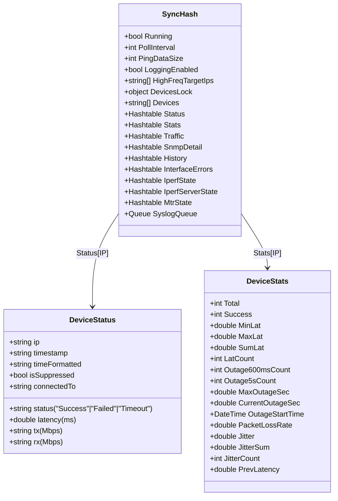
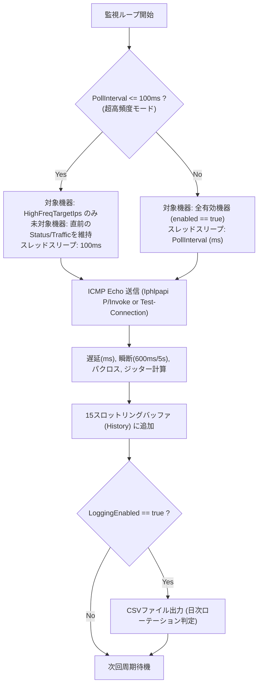
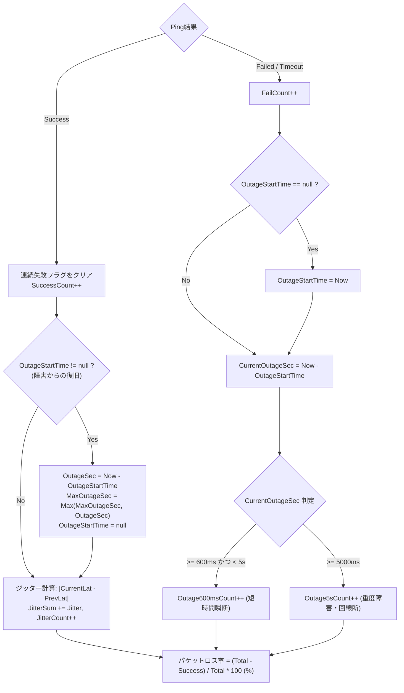
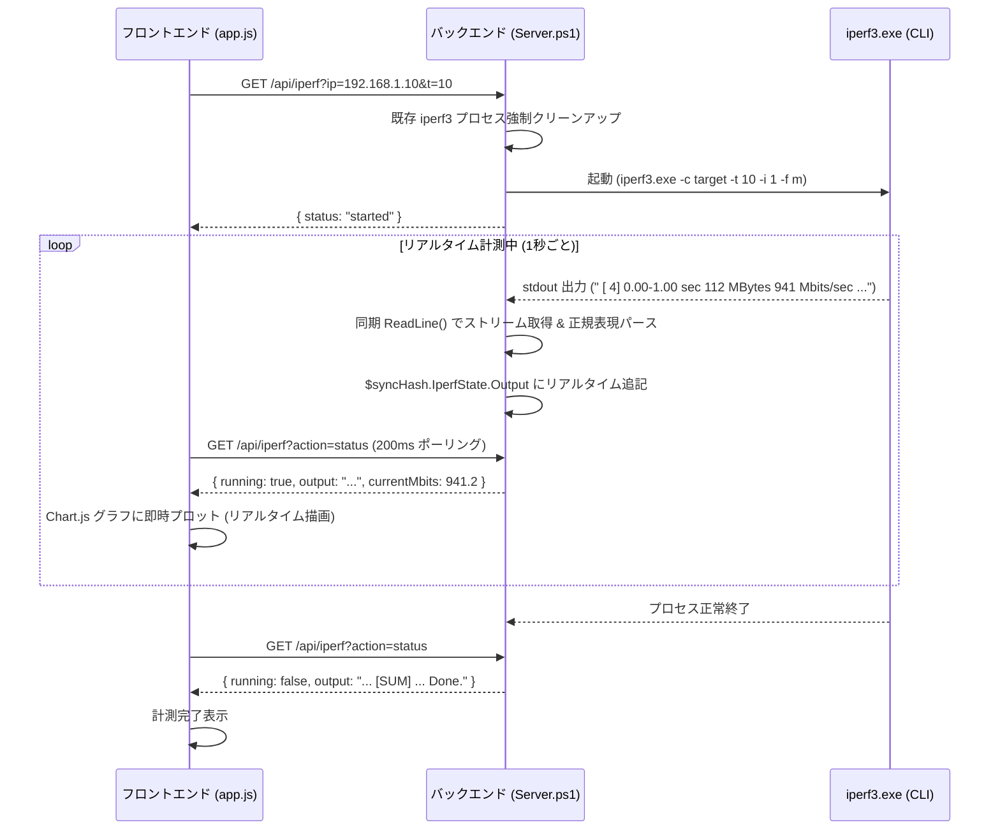
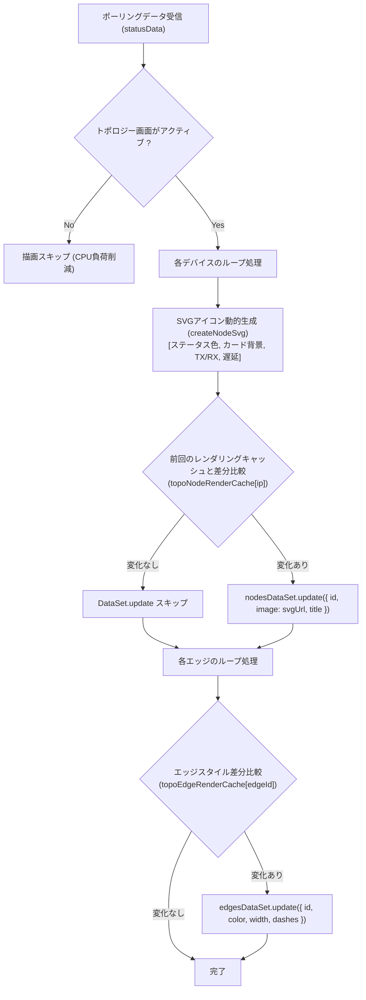
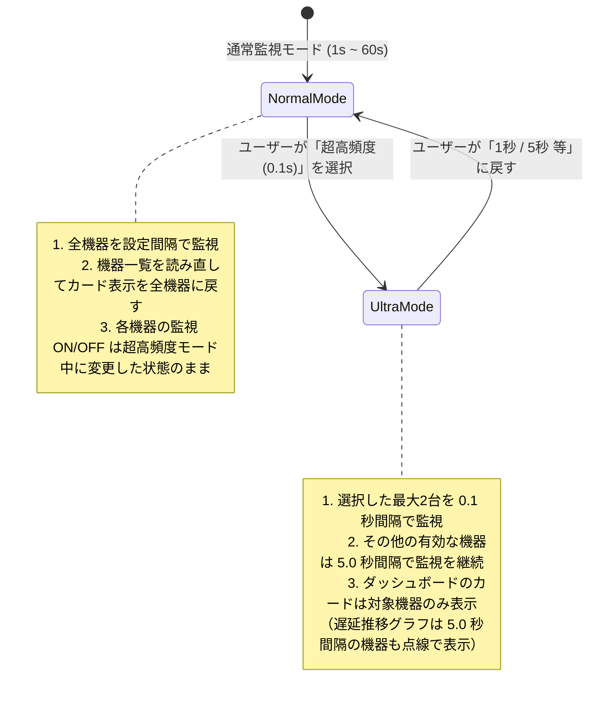
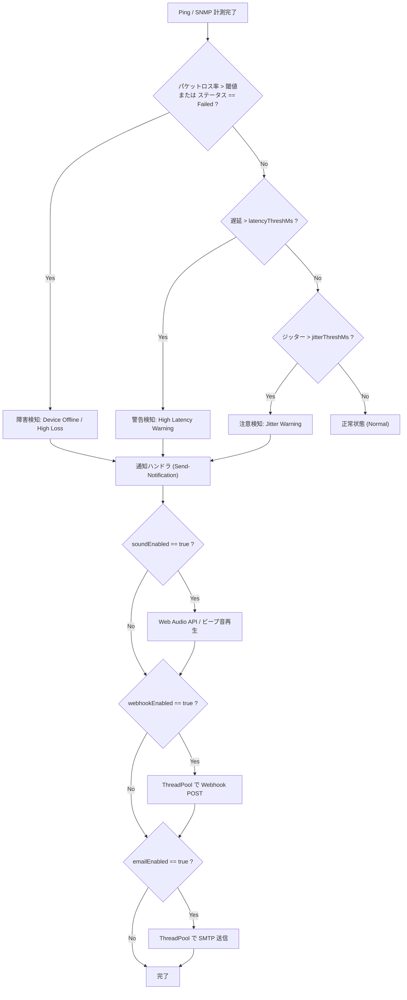
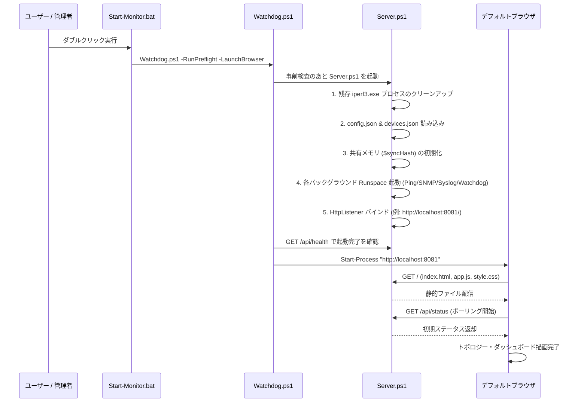

# Network Device Monitor - システム完全技術仕様書

本書は、「Network Device Monitor」のシステムアーキテクチャ、内部処理ロジック、データ構造、全REST API仕様、フロントエンド描画仕様、障害検出アルゴリズム、信頼性・セキュリティ設計を完全に網羅したエンジニア向け技術仕様書です。

---

## 目次

1. [システム概要と全体アーキテクチャ](#1-システム概要と全体アーキテクチャ)
   - [1.1 システム目的と特徴](#11-システム目的と特徴)
   - [1.2 技術スタック](#12-技術スタック)
   - [1.3 全体アーキテクチャ図](#13-全体アーキテクチャ図)
   - [1.4 プロセス・Runspace（スレッド）構成](#14-プロセスrunspaceスレッド構成)
   - [1.5 共有メモリモデルと排他制御](#15-共有メモリモデルと排他制御)
2. [データモデルと設定ファイル仕様](#2-データモデルと設定ファイル仕様)
   - [2.1 devices.json スキーマ定義](#21-devicesjson-スキーマ定義)
   - [2.2 config.json スキーマ定義](#22-configjson-スキーマ定義)
   - [2.3 $syncHash インメモリデータ構造](#23-synchash-インメモリデータ構造)
   - [2.4 出力ログ・CSV仕様](#24-出力ログcsv仕様)
3. [コア監視・計測エンジン仕様](#3-コア監視計測エンジン仕様)
   - [3.1 Ping監視エンジン & 超高頻度モード（100ms）](#31-ping監視エンジン--超高頻度モード100ms)
   - [3.2 瞬断・パケットロス・ジッター判定アルゴリズム](#32-瞬断パケットロスジッター判定アルゴリズム)
   - [3.3 SNMP トラフィック & エラー監視エンジン](#33-snmp-トラフィック--エラー監視エンジン)
   - [3.4 IPerf3 リアルタイム計測エンジン](#34-iperf3-リアルタイム計測エンジン)
   - [3.5 MTR (Visual Traceroute) エンジン](#35-mtr-visual-traceroute-エンジン)
   - [3.6 Syslog 受信・解析エンジン](#36-syslog-受信解析エンジン)
   - [3.7 自動トポロジー解決（CDP / LLDP / ARP / Route）](#37-自動トポロジー解決cdp--lldp--arp--route)
4. [全 REST API 完全仕様書](#4-全-rest-api-完全仕様書)
   - [4.1 API共通仕様](#41-api共通仕様)
   - [4.2 監視・ステータス系 API](#42-監視ステータス系-api)
   - [4.3 デバイス管理系 API](#43-デバイス管理系-api)
   - [4.4 システム設定・バックアップ系 API](#44-システム設定バックアップ系-api)
   - [4.5 診断・計測ツール系 API](#45-診断計測ツール系-api)
   - [4.6 ログ・監査・ライフサイクル系 API](#46-ログ監査ライフサイクル系-api)
5. [フロントエンド仕様 (UI / UX / 描画エンジン)](#5-フロントエンド仕様-ui--ux--描画エンジン)
   - [5.1 SPA 構造と画面遷移](#51-spa-構造と画面遷移)
   - [5.2 Vis-network トポロジー描画エンジン](#52-vis-network-トポロジー描画エンジン)
   - [5.3 超高頻度モード（0.1s）状態退避・復元仕様](#53-超高頻度モード01s状態退避復元仕様)
   - [5.4 Chart.js リアルタイムグラフとメモリ管理](#54-chartjs-リアルタイムグラフとメモリ管理)
   - [5.5 クライアント・ライフサイクル管理](#55-クライアントライフサイクル管理)
6. [アラート・通知・監査ログ仕様](#6-アラート通知監査ログ仕様)
   - [6.1 アラート判定フロー](#61-アラート判定フロー)
   - [6.2 Webhook 通知ペイロード仕様](#62-webhook-通知ペイロード仕様)
   - [6.3 SMTP メール通知仕様](#63-smtp-メール通知仕様)
   - [6.4 音声アラート仕様](#64-音声アラート仕様)
   - [6.5 監査ログ（audit.log）仕様](#65-監査ログauditlog仕様)
7. [高信頼性・例外回復・セキュリティ設計](#7-高信頼性例外回復セキュリティ設計)
   - [7.1 スレッドセーフティとデッドロック防止](#71-スレッドセーフティとデッドロック防止)
   - [7.2 Runspace 自己回復（Watchdog）機構](#72-runspace-自己回復watchdog機構)
   - [7.3 HTTP メインスレッド非ブロッキング設計](#73-http-メインスレッド非ブロッキング設計)
   - [7.4 外部プロセス（iperf3/tracert）のゾンビ化防止](#74-外部プロセスiperf3tracertのゾンビ化防止)
   - [7.5 セキュリティ・堅牢化設計](#75-セキュリティ堅牢化設計)
8. [ファイル構成と起動・運用シーケンス](#8-ファイル構成と起動運用シーケンス)

---

## 1. システム概要と全体アーキテクチャ

### 1.1 システム目的と特徴
本システムは、Windows環境において専用エージェントを導入することなく、PowerShell 5.1/7+ および標準Web技術を用いて以下の機能を提供するエンタープライズ向けネットワーク機器監視・可視化ソリューションです。

1. **超低遅延・高精度監視**: 最短 100ms（0.1秒）周期のPingによるミリ秒単位の瞬断・遅延・ジッター検知。
2. **SNMP v1/v2c/v3 トラフィック・エラー監視**: 64bitカウンタ対応のリアルタイム帯域（Mbps）およびIFエラー（CRC/Discard）の自動収集。
3. **Cisco Packet Tracer 風 動的トポロジー可視化**: グループ背景円、接続線、機器状態のSVG動的生成、差分キャッシュ描画。
4. **統合ネットワーク診断ツール群**: IPerf3 リアルタイムスループット計測（双方向/グラフ連動）、MTR（Visual Traceroute）、Syslog受信（RFC 3164/5424）、IPレンジスキャン。
5. **自己完結型・ポータブル稼働**: 外部Webサーバー不要。PowerShellの `HttpListener` をベースとしたマルチスレッドHTTPサーバーにより単一フォルダで完全稼働。

### 1.2 技術スタック
* **バックエンド**:
  * PowerShell 5.1 / PowerShell 7+
  * .NET Framework (`System.Net.HttpListener`, `System.Net.Sockets.UdpClient`, `System.Threading`, `System.Management.Automation.Runspaces`)
  * C# インラインP/Invoke（高精度タイマー `QueryPerformanceCounter`, `Iphlpapi.dll` ICMP API）
* **フロントエンド**:
  * HTML5 / CSS3 (CSS Variables, Flexbox/Grid, Glassmorphism UI)
  * Vanilla JavaScript (ES6+, 非同期 Fetch API, Web Audio API)
  * Vis-network.js (物理トポロジーネットワークグラフ描画)
  * Chart.js (リアルタイム時系列グラフ描画)
* **外部バイナリ**:
  * `iperf3.exe` (v3.18 64bit)
  * `tracert.exe` (Windows 標準)

---

### 1.3 全体アーキテクチャ図

```mermaid
flowchart TB
    subgraph Browser ["Webブラウザ (SPA Frontend)"]
        UI_Dash["ダッシュボード (Heatmap/List/Chart)"]
        UI_Topo["システムトポロジー (vis-network)"]
        UI_Iperf["IPerf3 リアルタイム計測画面"]
        UI_Syslog["Syslog / 監査ログ ビューア"]
        UI_Manage["機器管理 / システム設定"]
    end

    subgraph Backend ["PowerShell バックエンド (Server.ps1)"]
        subgraph MainThread ["メインスレッド"]
            HTTP_Listener["HttpListener (Port 8081 / 起動時指定)"]
            Router["REST API ルーター & 静的ファイル配信"]
        end

        subgraph ThreadPoolWorkers [".NET ThreadPool (非同期ワーカー)"]
            Worker_Scan["IP Range Scan"]
            Worker_Trace["Traceroute"]
            Worker_SnmpDetail["SNMP Detail Query"]
            Worker_Notify["Webhook / Email Sender"]
        end

        subgraph SharedMemory ["スレッド間共有メモリ ($syncHash)"]
            Sync_Devices["Devices / Config"]
            Sync_Status["Status / Stats / Traffic"]
            Sync_History["History (15-slot Ring Buffer)"]
            Sync_Iperf["IperfState / ServerState"]
            Sync_Syslog["SyslogQueue (Concurrent Queue)"]
            Sync_Locks["DevicesLock (Monitor Lock)"]
        end

        subgraph BackgroundRunspaces ["バックグラウンド Runspaces (常駐監視スレッド)"]
            RS_Ping["Runspace 1: Ping監視エンジン\n(通常 1s~60s / 超高頻度 0.1s)"]
            RS_SNMP["Runspace 3: SNMP基本トラフィック\n(Octets / Errors / Backoff)"]
            RS_SNMP_Det["Runspace 4: SNMPトポロジー収集\n(CDP / LLDP / Speed / Band)"]
            RS_Syslog["Runspace 5: Syslog UDP Listener\n(Port 514 / 1514)"]
            RS_Watchdog["Runspace 6: ハートビート監視 & キー監視\n(自動シャットダウン判定)"]
        end
    end

    subgraph External ["監視対象ネットワーク & 外部連携"]
        Devices["ネットワーク機器 (Switch/Router/Server/AP/Camera/UPS)"]
        SyslogSources["Syslog 送信元機器"]
        WebhookDest["Slack / Teams / Discord Webhook"]
        SMTPServer["SMTP メールサーバー"]
    end

    %% Communications
    UI_Dash <-->|REST API / Polling (2.5s or 100ms)| HTTP_Listener
    UI_Topo <-->|REST API / Topology Update| HTTP_Listener
    UI_Iperf <-->|Stream API / Status| HTTP_Listener
    UI_Syslog <-->|Log Query / Clear| HTTP_Listener
    UI_Manage <-->|CRUD API| HTTP_Listener

    HTTP_Listener --> Router
    Router -->|即時応答| SharedMemory
    Router -->|重い処理をオフロード| ThreadPoolWorkers

    RS_Ping <-->|ICMP Echo / Async Ping| Devices
    RS_SNMP <-->|SNMP v1/v2c/v3 Get/Walk| Devices
    RS_SNMP_Det <-->|SNMP Topology Walk| Devices
    Devices -->|UDP 514/1514| RS_Syslog

    RS_Ping --> SharedMemory
    RS_SNMP --> SharedMemory
    RS_SNMP_Det --> SharedMemory
    RS_Syslog --> SharedMemory
    RS_Watchdog --> SharedMemory

    Worker_Notify -->|HTTPS POST| WebhookDest
    Worker_Notify -->|SMTP / TLS| SMTPServer
```

---

### 1.4 プロセス・Runspace（スレッド）構成

| スレッド/Runspace名 | 担当処理 | 実行周期 / トリガー | スレッドモデル |
| :--- | :--- | :--- | :--- |
| **Main Thread** | `HttpListener` による HTTP リクエスト受付、静的ファイル配信、APIルーティング | 常時リッスン (同期ループ) | メインプロセス |
| **Runspace 1: Ping** | 監視対象機器へのPing送信、RTT計測、瞬断検知、パケットロス/ジッター計算（記録はメモリ上のキューへ） | 設定間隔（100ms 〜 60,000ms） | バックグラウンド Runspace |
| **Runspace 3: SNMP Basic** | SNMPトラフィック（In/Out Octets）およびエラー（Errors/Discards）収集、バックオフ制御 | 設定間隔（5秒 〜 30秒） | バックグラウンド Runspace |
| **Runspace 4: SNMP Detail** | インターフェースリンク速度、Wi-Fi周波数帯、CDP/LLDP隣接機器収集、トポロジー自動親子付け | 30秒固定周期 | バックグラウンド Runspace |
| **Runspace 5: Syslog** | UDP 514 / 1514 ポートでの Syslog パケット受信、パース、キュー格納 | UDPパケット受信時（即時） | バックグラウンド Runspace |
| **OBR Status** | OBR の無線接続状況の取得（`ObrStatus.psm1`）。状態ページを読めないときだけ `POST /index.htm`（`LOGIN_PASSWORD`）でログインし、`GET /public/stat/wlstast_main.htm?lang=en` の `stainfo` を読む。プロキシは使わない。パスワード誤り時は 5 分間隔に落とす | 機器ごとに 10 秒 | バックグラウンド Runspace |
| **Runspace 1b: Disk Writer** | メモリ上のキューから CSV ログへの追記（10MB で世代交代）、統計チェックポイント `_checkpoint.json` の保存。ドライブの書き込みが止まっても Ping 監視を止めないよう分離 | CSV: 10秒 / チェックポイント: 60秒 | バックグラウンド Runspace |
| **Runspace 6: Watchdog** | コンソールキー入力検知（Enterキー停止）、ブラウザハートビート監視（600秒無通信で自動保存＆終了） | 200ms 周期 | バックグラウンド Runspace |
| **ThreadPool Workers** | IPレンジスキャン、Traceroute、SNMP詳細クエリ、Webhook送信、メール送信 | APIリクエスト時に動的生成 | .NET ThreadPool |

---

### 1.5 共有メモリモデルと排他制御

すべてのスレッド間通信は、PowerShellの `[hashtable]::Synchronized(@{})` で作成された `$syncHash` を介して行われます。

```mermaid
flowchart LR
    subgraph Writers ["書き込みスレッド"]
        API["REST API (Main / Worker)"]
        PingRS["Ping Runspace"]
        SnmpRS["SNMP Runspace"]
    end

    subgraph Memory ["$syncHash (Synchronized Hashtable)"]
        DevList["Devices (@(IPs))"]
        DevMeta["DeviceName, Community, Group, ..."]
        LockObj["DevicesLock (Object)"]
        StatusMap["Status, Stats, Traffic, SnmpDetail"]
    end

    subgraph Readers ["読み込みスレッド"]
        Polling["/api/status (Main)"]
        Topo["Topology Resolver (RS4)"]
    end

    API -->|Monitor::Enter(DevicesLock)| LockObj
    API -->|Update| DevList
    API -->|Update| DevMeta
    LockObj -->|Monitor::Exit(DevicesLock)| API

    PingRS -->|Snapshot: $devs = $syncHash.Devices| DevList
    SnmpRS -->|Snapshot: $devs = $syncHash.Devices| DevList

    PingRS -->|Write| StatusMap
    SnmpRS -->|Write| StatusMap

    StatusMap -->|Read| Polling
    DevList -->|Read| Topo
```

#### 排他制御ルール
1. **`DevicesLock` による CRUD 排他制御**:
   デバイスリスト（`$syncHash.Devices`）およびメタデータハッシュテーブル（`Community`, `DeviceName`, `Group`, `IsMonitored` 等）を変更するAPI（`delete`, `add`, `bulk`, `edit`, `reorder`, `positions`, `bulk-action`, `import`）は、必ず以下のように `[System.Threading.Monitor]` で保護されます。
   ```powershell
   [System.Threading.Monitor]::Enter($syncHash.DevicesLock)
   try {
       # デバイス配列の再構築とハッシュテーブル更新
       Save-DevicesJson
   } finally {
       [System.Threading.Monitor]::Exit($syncHash.DevicesLock)
   }
   ```
2. **イミュータブル・スナップショット列挙**:
   各監視Runspaceは、ループ開始時に `$devices = $syncHash.Devices` で配列の参照スナップショットを取得してから `foreach` 処理を行います。これにより、反復処理中にAPIからデバイスが追加・削除されても `Collection was modified` 例外が発生しません。
3. **Syslog キューの排他制御**:
   `$syncHash.SyslogQueue`（`Queue`）へのアクセスは、`[System.Threading.Monitor]::Enter($syncHash.SyslogQueue.SyncRoot)` で排他制御されます。

---

## 2. データモデルと設定ファイル仕様

### 2.1 devices.json スキーマ定義
機器一覧を保存するJSONファイル（`system/devices.json`）のスキーマ定義です。

```json
[
  {
    "ip": "192.168.1.1",
    "name": "Core-RT01",
    "obrEnabled": false,
    "obrPassword": "enc:...",
    "community": "public",
    "group": "Core Network",
    "enabled": true,
    "image": "router",
    "connectedTo": "",
    "x": 100.5,
    "y": -50.2,
    "mac": "00:11:22:33:44:55",
    "vendorContact": "Cisco Support: 0120-xxx-xxx",
    "deviceType": "network",
    "webUrl": "https://192.168.1.1",
    "snmpVersion": "v2c",
    "snmpUser": "",
    "snmpAuthProto": "none",
    "snmpAuthPass": "",
    "snmpPrivProto": "none",
    "snmpPrivPass": ""
  }
]
```

#### フィールド定義表

| フィールド名 | 型 | デフォルト値 | 必須 | 説明 |
| :--- | :--- | :--- | :---: | :--- |
| `ip` | `string` | - | **Yes** | 機器のIPv4アドレス（一意の主キー） |
| `name` | `string` | `ip` と同一 | No | 表示名（ホスト名・機器名称） |
| `community` | `string` | `"public"` | No | SNMP v1/v2c コミュニティ名 |
| `group` | `string` | `""` | No | 所属グループ名（トポロジー図で同一グループの背景円を描画） |
| `enabled` | `boolean` | `true` | No | 監視有効フラグ（`false` の場合は監視一時停止） |
| `image` | `string` | `""` | No | アイコン種別（`router`, `switch`, `server`, `pc`, `printer`, `ap`, `camera`, `power`, `bridge`, またはアップロード画像URL） |
| `connectedTo` | `string` | `""` | No | 親ノードのIPアドレス（カンマ区切りで複数指定可能）。トポロジー図でエッジを結ぶ |
| `x`, `y` | `number` | `null` | No | トポロジー図上の固定座標（ドラッグ配置保存時） |
| `mac` | `string` | `""` | No | 機器のMACアドレス |
| `vendorContact` | `string` | `""` | No | ベンダー連絡先・保守契約番号 |
| `deviceType` | `string` | `"network"` | No | 機器カテゴリ（`network`, `server`, `client`, `iot`, `power`） |
| `webUrl` | `string` | `""` | No | 機器の管理GUI Web URL |
| `snmpVersion` | `string` | `"v2c"` | No | SNMPバージョン（`"v1"`, `"v2c"`, `"v3"`） |
| `snmpUser` | `string` | `""` | No | SNMPv3 ユーザー名（USM） |
| `snmpAuthProto`| `string` | `"none"` | No | SNMPv3 認証プロトコル（`"none"`, `"MD5"`, `"SHA"`, `"SHA256"`） |
| `snmpAuthPass` | `string` | `""` | No | SNMPv3 認証パスワード |
| `snmpPrivProto`| `string` | `"none"` | No | SNMPv3 暗号化プロトコル（`"none"`, `"DES"`, `"AES"`, `"AES128"`） |
| `snmpPrivPass` | `string` | `""` | No | SNMPv3 暗号化パスワード |
| `checkType`    | `string` | `"icmp"` | No | 死活監視方式（`"icmp"`: 通常Ping監視, `"tcp"`: TCPポート死活監視） |
| `port`         | `number` | `0` | No | TCP監視対象ポート番号（`0`〜`65535`。`checkType` が `"tcp"` の場合に使用） |

---

### 2.2 config.json スキーマ定義
監視エンジンの動作パラメータ（`system/config.json`）のスキーマ定義です。

```json
{
  "pollInterval": 1000,
  "pingDataSize": 32,
  "loggingEnabled": true,
  "highFreqTargetIps": [],
  "outageThresh1Ms": 600,
  "outageThresh2Ms": 5000,
  "latencyThreshMs": 50,
  "packetLossThreshPct": 5.0,
  "jitterThreshMs": 15.0,
  "logRetentionDays": 30,
  "webhookUrl": "https://hooks.slack.com/services/...",
  "webhookEnabled": false,
  "webhookOfflineOnly": true,
  "smtpHost": "smtp.gmail.com",
  "smtpPort": 587,
  "smtpSsl": true,
  "smtpUser": "alerts@example.com",
  "smtpPass": "********",
  "smtpFrom": "alerts@example.com",
  "smtpTo": "admin@example.com",
  "emailEnabled": false,
  "soundEnabled": true,
  "soundVolume": 0.8,
  "syslogEnabled": true,
  "syslogPort": 514,
  "trapPort": 162,
  "autoShutdownOnDisconnect": true
}
```

---

### 2.3 $syncHash インメモリデータ構造



---

### 2.4 出力ログ・CSV仕様

#### 1. 監視ログCSV (`Reports/sessions/<起動日時>/<IP>.csv`)
起動ごとのセッションフォルダに機器別CSVとして出力されます。Excel等での直接閲覧の利便性からデフォルトは Shift_JIS (CP932) で日本語ヘッダーにて保存されます。フロントエンドおよび `/api/history` では日本語・英語の両ヘッダーを自動識別する二重互換設計が実装されています。
```csv
タイムスタンプ,IPアドレス,ステータス,遅延_ms,帯域_Mbps,送信_Mbps,受信_Mbps,瞬断継続_sec,ジッター_ms
2026-08-30 06:00:01,192.168.1.1,Success,1.24,-,45.2,12.8,,0.12
2026-08-30 06:00:02,192.168.1.1,Success,1.31,-,46.1,13.2,,0.07
2026-08-30 06:00:03,192.168.1.1,Failed,,-,45.9,13.0,1.0,
```
※`帯域_Mbps` 列は過去の CSV と列の並びをそろえるために残しており、常に `-` です。以前は Ping の応答時間からの推定値が入っていましたが、実際の通信量とは無関係なため廃止しました。通信量は SNMP で取得できる機器の `送信_Mbps` / `受信_Mbps` を参照してください（取得できない機器は `-`）。

※REST API（`/api/history`）返却時およびフロントエンドグラフ描画時は、英語キー（`Timestamp, Latency_ms, Tx_Mbps, Rx_Mbps`）と日本語キーの双方が自動で正規化・マッピングされます。

#### 2. 監査ログ (`reports/audit.log`)
管理操作（機器の追加/編集/削除、一括変更、設定更新、ログクリア等）を記録します。
```text
[2026-08-30 06:01:23] ACTION: DEVICE_ADD | TARGET: 192.168.1.50 | DETAILS: Device Switch-02 (192.168.1.50) registered | CLIENT: 127.0.0.1
[2026-08-30 06:02:10] ACTION: CONFIG_UPDATE | TARGET: SystemConfig | DETAILS: PollInterval changed to 1000ms | CLIENT: 127.0.0.1
```

---

## 3. コア監視・計測エンジン仕様

### 3.1 Ping監視エンジン & 超高頻度モード（100ms）

Ping監視Runspace（`$pingScript`）は、登録された機器に対してICMP Echoリクエストを送信し、高精度なRTT計測と状態判定を行います。



* **通常モード（1s 〜 60s）**:
  全監視対象機器（`enabled !== false`）に対して並列/高速Pingを実行。
* **超高頻度モード（100ms / 0.1秒）**:
  特定の重要機器（`highFreqTargetIps`）のみを対象に100ms周期で極限計測。それ以外の機器は「直前の正常生存色・遅延・トラフィック」をキャッシュから維持し、無駄なICMPストームとCPU負荷を防止。
  ダッシュボードの遅延推移グラフ（`dashboard-unified-canvas`）には、対象外の有効な機器（5.0s間隔）も点線（`borderDash: [6,4]`）で描画し、凡例に `(5.0s)` を付ける。カードを表示しない機器も、グラフ用の履歴は `pushLatencyHistory()` で記録する。

---

### 3.2 瞬断・パケットロス・ジッター判定アルゴリズム

ミリ秒単位の回線品質低下およびマイクロ秒単位の瞬断を正確に捕捉します。



1. **瞬断カウンタ（600ms / 5s 判定）**:
   * **600ms瞬断**: Wi-FiローミングやSTP再計算、Spanning Treeトポロジー変更に伴うサブ秒単位の切断を捕捉。
   * **5秒瞬断**: 機器リブートや回線切断、ルーティング収束遅延などの重大障害を捕捉。
2. **ジッター計算**:
   直近 30 回の成功パケットの遅延について、隣り合う値の差の絶対値を平均して算出する（`RecentLatencies` から毎回計算）。RFC 3550 の平滑化の式は使っていない。

---

### 3.3 SNMP トラフィック & エラー監視エンジン

SNMP Runspace（`$snmpScriptBlock`）は、標準 MIB-II（RFC 1213 / RFC 2863 IF-MIB）から機器の通信量とインターフェース品質を取得します。

#### 1. 取得OID一覧

| 項目 | 32bit OID | 64bit 高速OID (HC) | 用途 |
| :--- | :--- | :--- | :--- |
| **In Octets** | `.1.3.6.1.2.1.2.2.1.10` | `.1.3.6.1.2.1.31.1.1.1.6` | 受信バイト数（Rx） |
| **Out Octets** | `.1.3.6.1.2.1.2.2.1.16` | `.1.3.6.1.2.1.31.1.1.1.10` | 送信バイト数（Tx） |
| **In Errors** | `.1.3.6.1.2.1.2.2.1.14` | - | 受信エラーパケット数（CRC/Frame等） |
| **Out Errors** | `.1.3.6.1.2.1.2.2.1.20` | - | 送信エラーパケット数（Collision等） |
| **In Discards** | `.1.3.6.1.2.1.2.2.1.13` | - | 受信廃棄パケット数（バッファ枯渇等） |
| **Out Discards**| `.1.3.6.1.2.1.2.2.1.19` | - | 送信廃棄パケット数（キュー溢れ等） |

#### 2. ロールオーバー対応 帯域算出式
32bitカウンタ（$2^{32} = 4,294,967,296$）のオーバーフローを自動補正して正確なMbpsを算出します。
$$\Delta \text{Bytes} = \begin{cases} \text{Current} - \text{Prev} & (\text{Current} \ge \text{Prev}) \\ (\text{Current} + 2^{32}) - \text{Prev} & (\text{Current} < \text{Prev}) \end{cases}$$
$$\text{Traffic (Mbps)} = \frac{\Delta \text{Bytes} \times 8}{\Delta \text{Time (sec)} \times 10^6}$$

#### 3. 早期スキップ & 指数バックオフ制御
SNMP未対応機器や無応答機器に対するタイムアウト遅延を解消する設計です。
* **早期スキップ**: 最初のOID（InOctets）への問い合わせがタイムアウトした場合、残りの5つのOID問い合わせを即座にスキップ。
* **指数バックオフ**: 連続失敗回数に応じて次回ポーリングまでのスキップ時間（30秒 $\to$ 60秒 $\to$ 120秒）を設定し、無駄なUDPパケット送信を停止。

---

### 3.4 IPerf3 リアルタイム計測エンジン

ネットワーク間の最大TCP/UDPスループットを計測・可視化します。



* **リアルタイム性**: 非同期バッファリング遅延を回避するため、PowerShell側で同期 `ReadLine()` をループ実行し、出力行を即座に共有メモリへ反映。
* **サーバー側のログ（UDP のみ）**: 追加オプションが UDP を指定しているとき（`Test-IperfUdpOptions`）は `--get-server-output` を自動で付ける。出力の `Server output:` から `iperf Done.` の手前までを、セッションフォルダの `remote_iperf_<IP>.log` に分けて保存する（`Get-IperfOutputRoute`）。画面の出力と計測ログ、統計サマリーには含めない。計測が正常に終わらなかったときは、サーバー側のログは届かないことがある。
* **計測中にブラウザを閉じた場合**: サーバー側のログは計測の終わりに届くので、ブラウザを閉じたことによる終了（`reason=unload` とハートビート切れ）は、計測の完了まで待つ。待つのは計測時間 + 120 秒まで。
* **計測中に明示の操作で終了した場合**: UDP の計測中だけ完了を待つ（TCP は待たない）。「監視終了」ボタンでは `POST /api/shutdown` の応答に `waitingForIperf: true` を返し、画面は完了後にサーバー側のログをダウンロードする。そのためサーバーは完了後 15 秒動き続ける。Enter キーでは完了を待ってファイルに保存して終了し、2 回目の Enter キーですぐに終了する。
* **強制停止**: `GET /api/iperf?action=stop` 受信時、`taskkill /F /T /PID` を実行して `iperf3.exe` プロセスツリーをミリ秒単位で完全強制終了。

---

### 3.5 MTR (Visual Traceroute) エンジン
対象ホップごとのRTTとパケットロスを可視化する診断エンジンです。
* `tracert -d -h 15 -w 300 {IP}` をバックグラウンド実行。
* 発見された各ホップ（ゲートウェイIP）に対して継続的なPingを実行し、ホップごとの遅延・ロス率をUI上にリアルタイム表示。

---

### 3.6 Syslog 受信・解析エンジン
ネットワーク機器からの障害通知ログ（RFC 3164 / RFC 5424）をリアルタイムに受信・蓄積します。
* **送信元の制限**: 登録済みの機器のアドレスから届いたものだけを受け付ける（`Test-LogSourceAllowed`。SNMP Trap も同じで、未登録の相手には Inform の返事も送らない）。無視した件数と最後の送信元は `/api/syslog` の `rejectedCount` / `rejectedLastIp` で返し、画面の「受信状態」に出す。UDP の送信元は偽装できるので、悪意のある相手を完全に防ぐものではない。
* **ポート**: `syslogPort`（既定 UDP 514）を開き、開けない場合は UDP 1514 で代わりに受信する。実際の受信ポートと失敗理由は `/api/syslog` の `listenPort` / `listenError` で返し、画面の「受信状態」に表示する。`syslogPort` を変更すると再起動なしで開き直す。
* **リングバッファ**: メモリ内に最新 500 件のログを保持（古いログから自動破棄）。
* **ファシリティ / セベリティ解析**: PRIヘッダ（`<134>`等）から Facility（`local0`, `auth` 等）および Severity（`Emergency`, `Alert`, `Critical`, `Error`, `Warning`, `Notice`, `Info`, `Debug`）を自動抽出。

### 3.6.2 OBR 無線接続状況の確認
機器ごとの設定 `obrEnabled` / `obrPassword`（DPAPI で暗号化して `devices.json` に保存）が有効な機器について、無線の接続状況を確認します。
* **結果**: `/api/status` の各機器の `obr` に `state`（`Connected` / `Disconnected` / `LoginFailed` / `Unreachable` / `NoPassword` / `DecryptFailed`）、`ssid`、`bssid`、`channel`、`signalDbm`、`txBitrate`、`checkedAt` を返す。
* **表示**: 機器カードと構成図のノード。構成図のノードでは通信量の表示位置に無線状況を出し、通信量はツールチップに残す。`Disconnected` は画面のアラートと音で通知する（Webhook・メールは送らない）。
* **履歴**: 確認結果を記録専用スレッドがセッションフォルダの `obr_wireless_<IP>.csv`（UTF-8 BOM 付き、10MB で `_1` へ切り替え）に追記する。2 回目以降の切り替えでは `_1` の古い記録が消えるので、目印の `obr_wireless_<IP>.discarded` を作る。機器の IP アドレスを変更すると、これらのファイル名も変更して履歴を引き継ぐ（変更先に同名のファイルがあるときは上書きしない）。確認は機器ごとに最大 8 台まで同時に行うので、応答の遅い機器があっても他の機器の 10 秒間隔は保たれる（同じ機器の確認が 10 秒で終わらないときは、終わってから次を始める）。`loggingEnabled` が false のときは記録しない。パスワード未設定・復号不可の状態は確認していないので記録しない。
* **履歴画面**: 機器カードの無線の表示を押すと、今回の起動分の履歴をモーダルで表示する。`GET /api/obr/history?ip=<IP>` が `obr_wireless_<IP>_1.csv` と `obr_wireless_<IP>.csv` を古い順に別スレッドで読み、`points`（`t`、`signal`、`rate`）と `events`（`disconnected` / `recovered` / `roamed` / `unreachable` / `loginFailed`）を返す。`points` は最大 2,000 点に間引き、区間の最小値をその時刻で残す。区間内に切断などがあるときは、グラフが途切れるよう値なしの点にする。`events` は間引く前の全行で判定し、最新 500 件を返す。最後の出来事は、最後の記録が 10 分以内なら `ongoing: true` で現在までの長さを返し、それより古ければ確認が止まったとみなして `ongoing: false` で最後の記録までの長さを返す。古い記録が消えているときは `olderDiscarded: true` を返し、画面に表示する。自動更新はせず、「更新」ボタンで読み直す。
* **注意**: OBR との通信は平文の HTTP。ログイン回数を減らすため、状態ページを読めるあいだは再ログインしない。

### 3.6.1 SNMP Trap 受信エンジン
機器から自発的に届く通知（SNMP Trap）を受信し、Syslog と同じ一覧（`SyslogQueue`、種類は `Kind = "Trap"`）に入れます。
* **ポート**: `trapPort`（既定 UDP 162）を開き、開けない場合は UDP 1162 で代わりに受信する。状態は `/api/syslog` の `trapListenPort` / `trapListenError` で返す。受信の ON/OFF は `syslogEnabled` と共通。
* **対応範囲**: SNMP v1 Trap、v2c Trap、v2c Inform（Inform には Response を返す）。解析は `SnmpService.psm1` の `ConvertFrom-SnmpTrapPacket` で行い、外部ライブラリに依存しない。SNMPv3 は暗号化されていて読めないため、案内を同じ送信元につき 1 分に 1 回まで表示する。
* **表示**: 標準の Trap（linkDown / linkUp / coldStart 等）は日本語の説明と重要度を付ける（`Get-SnmpTrapDisplay`）。コミュニティ名は表示しない。SNMP として読めないデータは無視する。

---

### 3.7 自動トポロジー解決（CDP / LLDP / ARP / Route）
SNMP 詳細収集 Runspace（`$snmpDetailScriptBlock`）が、以下のプロトコルMIBを走査してネットワーク結線（`connectedTo`）を自動解決します。
1. **CDP (Cisco Discovery Protocol)**: `.1.3.6.1.4.1.9.9.23.1.2.1.1`
2. **LLDP (Link Layer Discovery Protocol)**: `.1.0.8802.1.1.2.1.4.1.1`
3. **IP Route Table**: `.1.3.6.1.2.1.4.21.1.7` (NextHop IP)
4. **IP-to-Physical ARP Table**: `.1.3.6.1.2.1.4.22.1.2` (MAC-to-IP)

隣接機器のIPが監視対象一覧（`$syncHash.Devices`）に含まれている場合、自動的に `connectedTo` フィールドを更新してトポロジー図に結線を描画します。

---

### 3.8 ARPスキャン・IPアドレス競合自動検知エンジン
Ping監視Runspace（`$pingScript`）内で、約10秒周期でOSの近隣キャッシュ（`Get-NetNeighbor` / `arp -a`）を走査し、登録機器のIPアドレスに対するMACアドレスの整合性を常時検証します。
* **判定ロジック**:
  1. `devices.json` に手動登録されたMACアドレスが存在する場合: 観測されたMACアドレスが不一致であれば直ちに「IP競合」と判定。
  2. MACアドレス未登録の場合: 初回観測されたMACアドレスを `$syncHash.LearnedMac` として自動学習。学習済みMACから別のMACアドレスへと急変した際に「IP競合」と判定。
* **競合データの管理**:
  - `$syncHash.IpConflicts[IP]` に競合IP、機器名、期待MAC、検出MAC、検知日時を保持。
  - `/api/status` レスポンス（`_ipConflicts`）および専用API `/api/ip-conflicts` を介してリアルタイムにフロントエンドへ配信。
  - 競合が解消された（正常なMACアドレスに戻った）場合は自動で競合一覧から消去。

---

## 4. 全 REST API 完全仕様書

### 4.1 API共通仕様
* **ベースURL**: `http://localhost:8081` (または起動時指定ポート)
* **データフォーマット**: `Content-Type: application/json; charset=utf-8`
* **エラーレスポンス形式**:
  ```json
  {
    "error": "エラーメッセージ詳細"
  }
  ```

---

### 4.2 監視・ステータス系 API

#### 1. `GET /api/status`
全監視機器の最新ステータス、遅延、通信量、瞬断回数、IPerf状態を一括取得します。

* **レスポンス (200 OK)**:
```json
{
  "192.168.1.1": {
    "status": "Success",
    "latency": 1.24,
    "ip": "192.168.1.1",
    "timestamp": "2026-08-30T06:00:00",
    "timeFormatted": "06:00:00",
    "tx": "45.2",
    "rx": "12.8",
    "errors": {
      "1": { "inErr": 0, "outErr": 0, "inDisc": 0, "outDisc": 0, "dInErr": 0, "dOutErr": 0, "dInDisc": 0, "dOutDisc": 0 }
    },
    "maxOutageSec": 0.0,
    "currentOutageSec": 0.0,
    "outage600msCount": 0,
    "outage5sCount": 0,
    "packetLossRate": 0.0,
    "jitter": 0.12,
    "avgJitter": 0.15,
    "isSuppressed": false,
    "connectedTo": ""
  },
  "_iperf": {
    "Running": false,
    "Output": "",
    "LastUpdate": 0
  }
}
```

---

### 4.3 デバイス管理系 API

| メソッド | URL | 説明 | スレッドセーフティ |
| :--- | :--- | :--- | :--- |
| `GET` | `/api/devices` | 登録機器一覧（`devices.json`）の取得 | スナップショット読込 |
| `POST`| `/api/device` | 単一機器の新規追加 | `DevicesLock` 排他制御 |
| `POST`| `/api/devices/bulk` | 複数機器の一括追加・更新（送られた項目だけ更新し、省略した項目は登録済みの値を保つ。CSV インポートも使用） | `DevicesLock` 排他制御 |
| `POST`| `/api/device/edit` | 機器設定の編集（IP変更、アイコン、接続先等） | `DevicesLock` 排他制御 |
| `POST`| `/api/device/toggle` | 単一機器の監視有効/無効の切り替え | `DevicesLock` 排他制御 |
| `POST`| `/api/device/upload-image` | 機器アイコン用画像のアップロード（png/jpg/gif/webp/bmp/ico のみ・10MB まで。ファイル名は `X-File-Name` に URL エンコードして渡す） | ファイル保存 (`public/uploads`) |
| `POST`| `/api/devices/delete` | 機器の削除および関連履歴CSVのクリーンアップ | `DevicesLock` 排他制御 |
| `POST`| `/api/devices/reorder` | 機器の並び順（表示順序）の保存 | `DevicesLock` 排他制御 |
| `POST`| `/api/devices/positions`| トポロジー図上の座標（x, y）の一括保存 | `DevicesLock` 排他制御 |
| `POST`| `/api/devices/bulk-action`| 選択機器の一括操作（一時停止/再開/削除/グループ変更） | `DevicesLock` 排他制御 |
| `POST`| `/api/devices/import` | 機器設定のインポート（JSONによる一括復元） | `DevicesLock` 排他制御 |

#### `POST /api/device/edit` リクエスト例
```json
{
  "oldIp": "192.168.1.10",
  "newIp": "192.168.1.10",
  "name": "Core-SW01",
  "group": "Distribution",
  "community": "public",
  "enabled": true,
  "image": "switch",
  "connectedTo": "192.168.1.1",
  "vendorContact": "03-xxxx-xxxx",
  "deviceType": "network",
  "webUrl": "https://192.168.1.10"
}
```

---

### 4.4 システム設定・バックアップ系 API

| メソッド | URL | 説明 | 処理モデル |
| :--- | :--- | :--- | :--- |
| `GET` | `/api/config` | 現在のシステム設定取得 | 即時応答 |
| `POST`| `/api/config` | システム設定の更新（周期、閾値、通知先等） | 即時反映 & JSON保存 |
| `GET` | `/api/config/export` | 設定＋機器情報のフルバックアップJSON生成・ダウンロード | 即時ダウンロード |
| `POST`| `/api/config/import` | バックアップJSONからの完全リストア | `DevicesLock` 排他制御 |
| `GET` | `/api/snapshots/list` | 自動/手動作成された機器構成スナップショット一覧 | 即時応答 |
| `POST`| `/api/snapshots/restore` | 指定スナップショットからの機器構成ロールバック | `DevicesLock` 排他制御 |
| `POST`| `/api/config-backup/run` | 機器コンフィグSSH/TFTP自動取得（将来拡張用） | 非同期実行 |
| `GET` | `/api/config-backup/list` | 取得済みの機器コンフィグの一覧 | 即時応答 |
| `GET` | `/api/config-backup/diff` | `?f1=...&f2=...` で指定した 2 つの機器コンフィグの差分 | 即時応答 |

---

### 4.5 診断・計測ツール系 API

| メソッド | URL | パラメータ / ボディ | 説明 | 処理モデル |
| :--- | :--- | :--- | :--- | :--- |
| `GET` | `/api/iperf` | `?ip=...&t=秒&opts=...&bw=...` | IPerf3 クライアント計測開始 | プロセス起動 & ストリーム |
| `GET` | `/api/iperf` | `?action=stop` | 実行中 IPerf3 の強制終了 | `taskkill` 強制Kill |
| `GET` | `/api/iperf` | `?action=status` | IPerf3 のリアルタイム出力・実行状態の取得 | 即時応答 (ポーリング用) |
| `GET` | `/api/iperf/log` | `?ip=...` | 最新の IPerf3 計測ログのダウンロード | ファイル読込 |
| `GET` | `/api/iperf/remote-log` | `?ip=...`（省略すると最新） | UDP 計測で受け取ったサーバー側のログのダウンロード | ファイル読込 |
| `GET` | `/api/mtr` | `action`（start / status / stop） | MTR 経路診断の開始・結果取得・停止 | 非同期実行 |
| `POST`| `/api/iperf/server/start`| `{ port: 5201 }` | IPerf3 サーバーモード起動 | プロセス管理 |
| `POST`| `/api/iperf/server/stop`| - | IPerf3 サーバーモード停止 | プロセス管理 |
| `GET` | `/api/iperf/server/log`| - | IPerf3 サーバーログのダウンロード | ファイル読込 |
| `POST`| `/api/iperf/server/clear-log`| - | IPerf3 サーバーの画面出力のクリア | 即時応答 |
| `GET` | `/api/iperf/server/status` | - | IPerf3 サーバー稼働状態取得 | 即時応答 |
| `GET` | `/api/scan` | `?start=192.168.1.1&end=192.168.1.254` | IPレンジ並列Pingスキャン (最大20並列)。応答: `activeIps`（IP の配列）と `hosts`（`ip` / `name`: SNMP sysName か逆引き DNS / `mac`: ARP / `kind`: SNMP sysDescr か TTL からの推測）。SNMP は v2c の `public` で全台へ 1 回だけ問い合わせ、応答待ちは最大 1.2 秒、DNS は最大 1.5 秒 | **`ThreadPool` 非同期実行** |
| `GET` | `/api/traceroute` | `?target=192.168.1.1` | 経路トレース（最大 20 区間）。`hops`（`ip` は応答なしなら null、`latency`）と `reached` を返す。構成図の右クリックメニューから使用 | 完了時に応答（最大 30 秒ほど） |
| `GET` | `/api/web-check` | `?url=https://...` | 指定URLのHTTP応答ステータスおよびSSL証明書有効期限チェック | 即時応答 |

---

### 4.6 ログ・監査・ライフサイクル系 API

| メソッド | URL | 説明 |
| :--- | :--- | :--- |
| `GET` | `/api/health` | サーバー死活・メモリ使用量・スレッド健全性取得 |
| `GET` | `/api/system/prerequisites` | サーバー実行環境の前提モジュール・ツール診断結果返却 |
| `POST`| `/api/system/install-module` | 不足モジュール（`SNMP` のみ）の自動インストール実行 |
| `POST`| `/api/system/cleanup-reports` | 指定日数を超えた古いレポート・ログの一括パージ |
| `GET` | `/api/syslog` | 受信済み Syslog イベント一覧取得（リングバッファ最大500件） |
| `POST`| `/api/syslog/clear` | 受信済み Syslog の一覧のクリア |
| `GET` | `/api/ip-conflicts` | 検出中のIPアドレス競合（MACアドレス不一致・急変）情報一覧取得 |
| `GET` | `/api/audit-logs` | 操作監査ログ（`audit.log`）の取得 |
| `GET` | `/api/history` | 指定機器の過去ログ取得（日本語・英語ヘッダー自動正規化返却） |
| `GET` | `/api/obr/history` | 指定した OBR の無線履歴（グラフの点と出来事の一覧）を取得 |
| `GET` | `/api/device/logs` | 取得済みの機器ログの一覧 |
| `GET` | `/api/device/log-download` | `?file=...` で指定した機器ログのダウンロード |
| `GET` | `/api/device/log-presets` | 機器ログ取得のコマンドの候補 |
| `GET` | `/api/reports/export` | 点検報告書（HTML）の取得（`?period=today` など） |
| `POST`| `/api/email/test` | SMTP テストメール送信 (**`ThreadPool` 非同期実行**) |
| `POST`| `/api/webhook/test`| Webhook テスト通知送信 (**`ThreadPool` 非同期実行**) |
| `GET` | `/api/heartbeat` | クライアント生存通知（タイムアウトタイマー延長） |
| `POST`| `/api/shutdown` | ブラウザ終了時のサーバー安全終了ビーコン |
| `POST`| `/api/test-results` | フロントエンド自動テスト結果（`test_results.json`）の保存 |

---

## 5. フロントエンド仕様 (UI / UX / 描画エンジン)

### 5.1 SPA 構造と画面遷移
フロントエンドはフレームワークを使用しない Pure Vanilla JavaScript による SPA (Single Page Application) です。
* **ダッシュボード画面 (`view-dashboard`)**:
  * グループ別タブ切り替え、機器ステータスカード一覧、ヒートマップタイムライン、Chart.js 遅延推移グラフ、サマリー統計。
* **システムトポロジー画面 (`view-topology`)**:
  * Vis-network による Packet Tracer 風グラフィカル結線図、ドラッグ＆ドロップ接続、右クリックコンテキストメニュー、機器詳細編集モーダル。
* **IPerf3 計測画面 (`view-iperf`)**:
  * サーバー/クライアント切り替え、リアルタイム折れ線グラフ、コンソールリアルタイムストリーミング出力、設定プリセット。
* **Syslog / 監査ログ画面 (`view-syslog`)**:
  * ファシリティ/セベリティ色分けテーブル、リアルタイム受信、フィルタリング検索。
* **機器・システム管理画面 (`view-manage`)**:
  * 機器一覧テーブル、CSV/JSON一括インポート・エクスポート、監視パラメータ設定、通知先設定。

---

### 5.2 Vis-network トポロジー描画エンジン



1. **動的 SVG ノード生成 (`createNodeSvg`)**:
   各ノードは HTML5 インライン SVG として動的にレンダリングされます。機器種別アイコン、生存状態カラーリング（緑：正常 / 黄：高遅延・注意 / 赤：オフライン / 灰：停止中）、通信量バッジ（Tx/Rx Mbps）、遅延バッジが単一のSVG画像としてVis-networkに提供されます。
2. **Cisco Packet Tracer 風 グループ背景円**:
   Vis-network の `beforeDrawing` イベントフックを使用し、同一 `group` に属するノード群の重心座標 $(c_x, c_y)$ と最大半径 $R$ をリアルタイム計算して、半透明のカラーサークルとグループラベルを描画します。
3. **差分レンダリングキャッシュ**:
   `topoNodeRenderCache` および `topoEdgeRenderCache` により、前回のSVGデータURLおよびツールチップ文字列と完全一致する場合は `nodesDataSet.update()` をスキップ。高頻度ポーリング時でもCanvasの再描画を極小化します。

---

### 5.3 超高頻度モード（0.1s）切り替え仕様

0.1秒モード切り替え時の状態遷移です。対象外の機器は一時停止せず 5.0 秒間隔で監視を続けるため、各機器の監視 ON/OFF（enabled）は変更・退避・復元しません。



> 2026-10-30 変更: 以前は通常モードへ戻すときに、超高頻度モードに入る前の監視 ON/OFF 状態をブラウザに保存しておいて復元していたため、超高頻度モード中に ⏸/▶ で切り替えた状態が元に戻されていました。現在は復元しません。

---

### 5.4 Chart.js リアルタイムグラフとメモリ管理
* **リングバッファ構造**:
  * ダッシュボード遅延グラフ（`dashboardUnifiedChart`）: 最新 15 点固定。
  * IPerf3 帯域グラフ（`iperfChart`）: 最大 60 点でスライス（`slice(-60)`）。
* **メモリリーク対策**:
  タブ切り替え時やモーダル破棄時に Chart.js インスタンスの `destroy()` を確実に呼び出し、DOM参照を解放。

---

### 5.5 クライアント・ライフサイクル管理
* **ハートビート (`setInterval 2500ms`)**:
  ブラウザが生存している間、2.5秒ごとに `/api/heartbeat` をGET送信。
* **フォアグラウンド復帰時の即時同期**:
  `document.addEventListener('visibilitychange')` および `window.addEventListener('focus')` により、タブがバックグラウンドから復帰した瞬間に即座にハートビートを再送し、サーバー側のタイムアウト（60秒）を確実にリセット。
* **安全な終了ビーコン (`navigator.sendBeacon`)**:
  ブラウザのタブ/ウィンドウが閉じられた際、`beforeunload` / `pagehide` イベントで `/api/shutdown` を送信し、サーバープロセスを安全に終了・ログ保存。

---

## 6. アラート・通知・監査ログ仕様

### 6.1 アラート判定フロー



---

### 6.2 Webhook 通知ペイロード仕様
Slack、Microsoft Teams、Discord、汎用Webhookに自動対応するJSONペイロードです。

```json
{
  "text": "🚨 【障害検知】Core-SW01 (192.168.1.10) がオフラインになりました",
  "attachments": [
    {
      "color": "#ef4444",
      "title": "ネットワーク監視アラート - Device Offline",
      "fields": [
        { "title": "対象機器", "value": "Core-SW01", "short": true },
        { "title": "IPアドレス", "value": "192.168.1.10", "short": true },
        { "title": "所属グループ", "value": "Core Network", "short": true },
        { "title": "発生時刻", "value": "2026-08-30 06:15:30", "short": true },
        { "title": "詳細", "value": "ICMP Echo 応答なし (Ping Timeout)", "short": false }
      ]
    }
  ]
}
```

---

### 6.3 SMTP メール通知仕様
* **プロトコル**: SMTP / SMTPS (STARTTLS / SSL 対応)
* **認証**: プレーン認証 / STARTTLS / SSL/TLS (ポート 25, 465, 587 対応)
* **件名フォーマット**:
  * 障害時: `【障害検知】ネットワーク機器監視システム - {DeviceName} ({IP}) オフライン`
  * 復旧時: `【復旧完了】ネットワーク機器監視システム - {DeviceName} ({IP}) オンライン復帰`

---

### 6.4 音声アラート仕様
* **実装方式**: Web Audio API (`AudioContext` によるビープ音シンセサイズ) および `Audio` オブジェクトによる音声ファイル再生。
* **音量制御**: `soundVolume` (0.0 〜 1.0) に連動。
* **サウンド種別**:
  * オフライン（障害）: 高音ビープ（警報音）
  * オンライン（復旧）: チャイム音
  * 瞬断検知: 短音クリック

---

### 6.5 監査ログ（audit.log）仕様
システムの全変更操作を `reports/audit.log` にタイムスタンプ付きで記録します。

| アクション名 | 記録契機 | 記録内容 |
| :--- | :--- | :--- |
| `DEVICE_ADD` | 機器新規登録時 | 機器名、IP、登録クライアントIP |
| `DEVICE_EDIT` | 機器設定変更時 | 変更前後のIP、変更項目名 |
| `DEVICE_DELETE` | 機器削除時 | 削除対象IP |
| `CONFIG_UPDATE` | システム設定変更時 | 変更されたパラメータ名と新しい値 |
| `BULK_ACTION` | 一括操作実行時 | 操作種別（pause/resume/delete等）、対象IPリスト |
| `SYSLOG_CLEAR` | Syslogバッファ消去時 | 実行クライアントIP |
| `EMAIL_TEST` | メール送信テスト時 | 送信先アドレス、成否 |

---

## 7. 高信頼性・例外回復・セキュリティ設計

### 7.1 スレッドセーフティとデッドロック防止
* **個別ロックの原則**: `$syncHash` 全体をロックするのではなく、書き込み競合が発生するリソースごとに専用のロックオブジェクト（`DevicesLock`, `SyslogQueue.SyncRoot`）を使用。
* **短いロック保持時間**: `Monitor::Enter` 内ではインメモリ更新とJSONファイル保存のみを行い、HTTP通信やスレッドスリープなどの重い処理はロック外で実行。
* **Monitor::Exit の finally 保証**: すべてのロック獲得箇所で `try ... finally` を徹底し、例外発生時でもロック解放漏れによるデッドロックを完全に防止。

### 7.2 Runspace 自己回復（Watchdog）機構
監視スレッド内で外部ネットワーク起因のソケット例外やメモリ不足が発生しても、プロセスがクラッシュしない多重保護構造を採用しています。

```powershell
# 各 Runspace の基本設計パターン
while ($syncHash.Running) {
    try {
        # 監視・計測処理
    } catch {
        # 例外を debug.log に記録し、数秒待機して自動再試行
        try { [System.IO.File]::AppendAllText($logPath, "Error: $($_.Exception.Message)`r`n", [System.Text.Encoding]::UTF8) } catch {}
        Start-Sleep -Seconds 5
    }
}
```

### 7.3 HTTP メインスレッド非ブロッキング設計
`HttpListener` を実行するメインスレッドは、数ミリ秒以内にレスポンスを返す処理のみを同期実行します。
* **非同期オフロード対象**:
  * `/api/scan`（最大254アドレスへの並列Ping）
  * `/api/traceroute`（最大20ホップの経路探索）
  * `/api/device/snmp-details`（複数MIBテーブルのWalk処理）
  * `/api/email/test`, `/api/webhook/test`（外部通信）
* **オフロード実装**: `[System.Threading.ThreadPool]::QueueUserWorkItem` を使用し、処理完了時に `HttpListenerResponse` へ直接JSONを出力して接続をクローズ。

### 7.4 外部プロセス（iperf3/tracert）のゾンビ化防止
* **起動前クリーンアップ**: サーバー起動時（`Server.ps1` 冒頭）に、以前のセッションで残存した `iperf3.exe` を自動検出して安全に終了。
* **プロセスツリー Kill**: 停止要求時は `taskkill /F /T /PID {PID}` を発行し、子プロセスを含めて確実に強制終了。

### 7.5 セキュリティ・堅牢化設計
* **Path Traversal 防御**: 静的ファイル配信時、リクエストパスの正規化（`GetFullPath`）を行い、`publicDir` 外へのディレクトリトラバーサルアクセスを `403 Forbidden` で遮断。
* **IPアドレス形式の厳格検証**: すべてのAPI入力において、正規表現 `^(?:(?:25[0-5]|2[0-4][0-9]|[01]?[0-9][0-9]?)\.){3}(?:25[0-5]|2[0-4][0-9]|[01]?[0-9][0-9]?)$` によるIPv4形式検証を実施。
* **SNMPv3 暗号化通信**: SHA / AES による USM 認証暗号化を完全サポートし、平文コミュニティ名漏洩リスクを排除。
* **接続元の制限（このPC以外の拒否）**: `http://localhost:<port>/` で待ち受けていても、HTTP.sys は `Host: localhost` と書かれた要求をネットワーク側からも受け取るため、全リクエスト（画面と `/api/*`）をルーティング前に `Test-ClientAddressAllowed`（`Common.psm1`）で検査する。接続元アドレスがループバック（`127.0.0.0/8`, `::1`, `::ffff:127.0.0.1` など）以外の場合は `403`（`status: FORBIDDEN_CLIENT`）で遮断する。同じPCの LAN 側アドレス宛ての接続も遮断対象。同じPC上の他のユーザーからの接続は、次の認証で防ぐ。
* **認証（合言葉）**: 全リクエスト（`/api/health` を除く）に合言葉を求め、なければ API は `401`（`status: UNAUTHORIZED`）、画面は `401` の案内ページを返す。合言葉は `Get-AppAuthToken` が初回に作り（ランダムな 32 バイト）、`%LOCALAPPDATA%\NetworkDeviceMonitor\auth_token.txt` に保存する（Windows のユーザーごとのフォルダで、Git の管理対象にもならない）。`Watchdog.ps1` がブラウザを `/?auth=<合言葉>` で開くと、サーバーはクッキー `NDM_Auth`（`HttpOnly` / `SameSite=Strict` / 1 年）を設定して `/` へ移動させる。ブラウザ以外のプログラムは `X-NDM-Auth` ヘッダーで渡す。起動中に `Start-Monitor.bat` を実行すると、2 つ目のサーバーを起動せず、既定のブラウザで画面を開いて終わる。同じ Windows ユーザーで動くプログラムと管理者は合言葉を読めるので防げない。`/?auth=` の URL はブラウザの履歴に残る。
* **操作の制限**: `POST /api/system/install-module` は `SNMP` のみインストールする（それ以外は失敗を返す）。`/api/shutdown` は `POST` のみ受け付ける。`/api/iperf` の追加オプションは `ConvertTo-SafeIperfOptions`（`Common.psm1`）で検査し、PC 内のファイルを扱うオプション（`-F` / `--file` / `-I` / `--pidfile` / `--logfile`。まとめ書きや省略形を含む）を取り除く。
* **応答の保護ヘッダー**: 全応答に `X-Frame-Options: DENY` / `Content-Security-Policy: frame-ancestors 'none'`（別サイトへの埋め込み禁止）と `X-Content-Type-Options: nosniff`（ファイル種類の推測禁止）を付ける。
* **CSRF（外部サイトからの API 呼び出し）防御**: `/api/*` へのリクエストは、ルーティング前に `Test-ApiRequestAllowed`（`Common.psm1`）で検査。`Origin` ヘッダーが `http://localhost:<port>` / `http://127.0.0.1:<port>` / `http://[::1]:<port>` 以外、または `Sec-Fetch-Site` が `same-origin` / `none` 以外（`cross-site`, `same-site`）の場合は `403`（`status: FORBIDDEN_ORIGIN`）で遮断。`Access-Control-Allow-Origin: *` は返さない（UI は同一オリジンのため不要）。ヘッダーを付けないブラウザ以外のクライアント（PowerShell, テスト, Watchdog の `/api/health`）は従来どおり利用可能。
* **リモート実行のコマンド注入防御**（`RemoteExec.psm1`）:
  * SSH: 接続先・鍵パス・コマンドを `ConvertTo-ProcessArgument`（MSVC 引数解析規則に準拠したエスケープ）で 1 引数として渡し、`-` で始まる接続先/ユーザー名は `INVALID_TARGET` で拒否。パスワードは環境変数 `NDM_SSH_PASS` 経由で askpass（遅延展開 `!NDM_SSH_PASS!`）に渡し、ディスクへは書き込まない。パスワードに非 ASCII 文字を含む場合は、cmd の `echo` がコードページ変換で文字化けさせるため、askpass を `powershell.exe` で UTF-8 バイト列を直接出力する版に切り替える（`Get-SshAskPassScript`）。
  * WinRM: 実行スクリプトは固定文とし、接続先・認証情報・コマンドは環境変数（`NDM_REMOTE_HOST/USER/PASS/CMD`）で渡して `[ScriptBlock]::Create()` で生成。コマンド文字列が監視PC側の構文として解釈されることはない。
  * Custom: 仕様として監視PC上で `cmd.exe` によりコマンドを実行するため、上記の接続元の制限と CSRF 防御が前提となる。置換変数は `{ip}` / `{name}` / `{user}` / `{port}`（`{command}` は置換しない）。
* **リモート実行の非同期化**: `/api/device/remote-exec` と `/api/device/fetch-log` の実行本体は `Start-BackgroundScript`（`$asyncWorkerPool`, 最大10並列）で行い、HTTP 受付ループ・`/api/health` を最大300秒のコマンド実行中もブロックしない（Watchdog による誤った強制再起動を防止）。
* **入力値・異常系の堅牢化**: `timeoutSec` は `[int]::TryParse` で検証し、数値以外・範囲外（1〜300秒以外）は既定値（remote-exec: 15秒 / fetch-log: 20秒）に戻す。CSRF ガードは `Test-ApiRequestAllowed` が使えない（`Common.psm1` 読み込み失敗）場合も例外で落ちず、`Origin` / `Sec-Fetch-Site` 付きのブラウザ要求は遮断、ヘッダーなしのクライアント（Watchdog）は許可する。
* **タイムアウト時のプロセスツリー終了**: `Invoke-ProcessWithTimeout` はタイムアウト時に `taskkill /T /F /PID` で子プロセスごと終了し、失敗時は `Process.Kill()` で本体を終了する。
* **実行確認ダイアログ**: 安全確認チェックボックスは開くたびに未チェックで始まり、チェックするまで実行ボタンは無効。機器ログ検索のハイライトは生テキストを分割してから各部分をエスケープするため、`&amp;` などの実体参照内で一致して表示が崩れることはない。
* **WinRM 再起動**: `rebootCommand` 登録時はそれを `Invoke-Command` で実行。未登録かつパスワード認証設定時はその資格情報で `Restart-Computer -Force`。どちらもない場合のみ `shutdown.exe /m \\host` を監視PCのログインユーザー権限で実行。

---

## 8. ファイル構成と起動・運用シーケンス

### 8.1 ディレクトリ構成

```text
NetworkDeviceMonitor/
├── .github/                  # GitHub 用の README.md・LICENSE (隠しフォルダ)
├── .claude/                  # 開発ツール用の CLAUDE.md (隠しフォルダ)
├── 利用手順書.html             # エンドユーザー向け操作マニュアル
├── Start-Monitor.bat         # ワンクリック起動バッチ
├── Reports/                  # 永続ログ・レポート保存先
│   ├── audit.log             # 操作監査ログ
│   ├── Configs/              # 機器コンフィグバックアップ保存先
│   └── (起動日時)/           # 各セッションのPing履歴CSV・点検報告書
└── system/                   # システムコアディレクトリ
    ├── Server.ps1            # バックエンドサーバー & 監視コアエンジン
    ├── Watchdog.ps1          # サーバーの死活監視と自動再起動
    ├── tools/                # 起動前の点検と補助のスクリプト
    │   ├── Check-Prerequisites.ps1 # 前提モジュールの確認
    │   ├── Ensure-Utf8Bom.ps1      # BOM の検査と付与
    │   ├── Launcher.ps1            # 機器ごとの監視ウィンドウを開くランチャー
    │   ├── Monitor-SingleDevice.ps1 # 1 台分の監視ウィンドウ
    │   ├── Stop-All.bat            # 監視ウィンドウを一括終了 (同じフォルダに .stop_signal を置く)
    │   ├── Service-Setup.bat       # 自動起動の登録
    │   └── Start-BandwidthServer.ps1 # 帯域計測の受け側を起動
    ├── docs/                 # 資料
    │   ├── SPECIFICATION.md        # システム完全技術仕様書 (本書)
    │   ├── 管理者向け設計書.html     # 管理者向け資料
    │   ├── GEMINI.md               # 開発の運用ルール
    │   ├── CYCLE.md                # 自律サイクルの手順
    │   └── PLAN.md / PROGRESS.md   # タスクと進捗の記録
    ├── config.json           # システム設定ファイル (Git の管理対象外)
    ├── devices.json          # 監視対象機器リスト (Git の管理対象外)
    ├── devices.example.json  # devices.json の形式の見本
    ├── modules/              # 機能ごとのモジュール
    ├── tests/                # 自動テスト
    ├── iperf3.18_64/         # iperf3 実行バイナリ (64bit)
    │   ├── iperf3.exe
    │   └── cygwin1.dll
    └── public/               # フロントエンド静的ファイル群
        ├── index.html        # SPA メインHTML
        ├── app.js            # フロントエンド制御ロジック
        ├── style.css         # UIスタイルシート
        ├── vis-network.min.js# トポロジー描画ライブラリ
        ├── chart.js          # グラフ描画ライブラリ
        ├── third-party-notices.html # 同梱ソフトウェアのライセンス表記
        └── uploads/          # ユーザーアップロード機器画像
```

---

### 8.2 起動シーケンス



---

### 8.3 終了シーケンス
1. **ブラウザを閉じた場合**:
   * ブラウザが `navigator.sendBeacon('/api/shutdown')` を送信。
   * サーバー側で `PendingShutdown` フラグが立ち、ログファイルを安全に保存して `HttpListener` を停止、全Runspaceを解放してPowerShellプロセスが正常終了。
2. **コンソールで Enter キーを押した場合**:
   * `$keyScript` がキー入力を検知し、`$syncHash.Shutdown = $true` を設定。
   * 全スレッドを安全に停止し、CSVバッファをフラッシュして終了。
3. **ブラウザ切断（クラッシュ・電源断）**:
   * ハートビートが 600 秒間途絶えた場合、Watchdog Runspace が自動切断を検知し、安全にログを保存してサーバーを自動停止。
